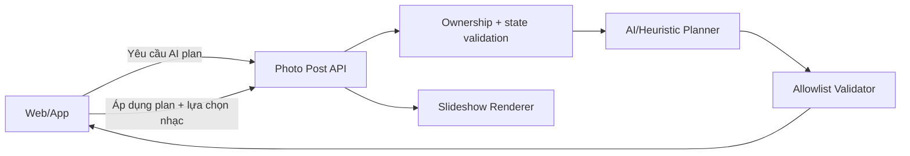

# URD — AI Photo Slideshow Director

- Feature: `ai-photo-slideshow-director`
- Version: 0.1
- Trạng thái: Approved scope / implementation pending
- Ngày: 2026-11-05
- Nguồn duyệt: người dùng xác nhận “oki bắt đầu” cho PLAN 0.1.

## I. Thông tin chung

### 1. Mục đích

Cho phép chủ job bài đăng ảnh yêu cầu AI tạo một phương án dựng video và gợi ý nhạc đồng bộ; người dùng xem, nghe thử, chỉnh và áp dụng trước khi tạo video. AI không tự tiêu quota hay render.

### 2. Phạm vi

- Backend planner AI + heuristic fallback, validator và API.
- Renderer hỗ trợ thứ tự, thời lượng, motion và transition theo plan allowlist.
- Web/app có cùng chức năng tạo plan, xem lý do, nghe thử/chọn nhạc và áp dụng.
- Giữ nguyên luồng thủ công và renderer cũ làm fallback.
- Không tự loại ảnh; AI được đổi thứ tự khi `keep_original_order=false`; độ dài AI gợi ý nhưng người dùng được chỉnh.

### 3. Thuật ngữ

| Thuật ngữ | Ý nghĩa |
|---|---|
| SlideshowPlan | Snapshot phương án dựng đã được server validate |
| AI Director | Planner kết hợp model và heuristic để tạo SlideshowPlan |
| Manual flow | Luồng chọn độ dài/nhạc hiện tại không dùng plan |

### 4. Nguồn

| Source ID | Nguồn | Trạng thái | Yêu cầu |
|---|---|---|---|
| SRC_01 | `ANALYSIS.md` 0.1 | Đã đọc | UC_01–UC_03 |
| SRC_02 | `PLAN.md` 0.1 | Đã duyệt | Toàn bộ |
| SRC_03 | Source photo post/music suggestions/slideshow hiện tại | Đã đọc | Tương thích/fallback |

## II. Tổng quan

Actor chính là chủ job đã đăng nhập. Server xác minh ownership, entitlement và trạng thái `awaiting_input`; model không phải nguồn tin cậy. Toàn bộ output model phải qua parser allowlist trước khi trả client hoặc render.

## III. Yêu cầu chi tiết

### UC_01 — Tạo phương án dựng AI

| Thuộc tính | Nội dung |
|---|---|
| Actor | Chủ job |
| Trigger | Bấm `AI dựng tối ưu` |
| Pre-condition | Đăng nhập; sở hữu job; job `awaiting_input`; ảnh còn tồn tại |
| Post-condition | Trả SlideshowPlan hợp lệ; không reserve quota, không render |

| BR | Quy tắc |
|---|---|
| BR01_01 | Chỉ owner được xem/tạo plan; object khác trả 404 |
| BR01_02 | Model chỉ nhận số ảnh/byte giới hạn; timeout tối đa 120 giây |
| BR01_03 | style/motion/transition/role là enum allowlist; index, duration, score được clamp/validate |
| BR01_04 | Model lỗi hoặc output không dùng được phải trả heuristic plan |
| BR01_05 | `keep_original_order=true` bắt buộc giữ thứ tự ảnh gốc |
| BR01_06 | MVP không tự bỏ ảnh; mỗi ảnh hợp lệ xuất hiện đúng một lần trong plan |

### UC_02 — Review và chỉnh plan

| BR | Quy tắc |
|---|---|
| BR02_01 | UI hiển thị style, mood, summary, thời lượng, nguồn plan và nhạc gợi ý |
| BR02_02 | Người dùng nghe thử tối đa một bài tại một thời điểm |
| BR02_03 | Người dùng được đổi thời lượng và nhạc trước khi tạo video |
| BR02_04 | Người dùng được phân tích lại hoặc quay về manual flow |

### UC_03 — Render theo plan

| BR | Quy tắc |
|---|---|
| BR03_01 | Client gửi `slideshow_plan` đã nhận; server validate lại với ảnh/job/track hiện tại |
| BR03_02 | Chỉ khi chọn tạo video mới reserve quota và queue job |
| BR03_03 | Renderer chỉ dùng motion `slow_zoom_in`, `slow_zoom_out`, `pan_left`, `pan_right`, `pan_up`, `pan_down`, `static`; transition `cut`, `crossfade`, `fade` |
| BR03_04 | Payload cũ không có plan tiếp tục dùng renderer hiện tại |
| BR03_05 | Plan không hợp lệ trả 400, không fallback âm thầm tại thời điểm áp dụng |

### Acceptance criteria

| AC | Given | When | Then |
|---|---|---|---|
| AC01 | Owner và job chờ lựa chọn | Tạo AI plan | Nhận plan hợp lệ hoặc heuristic, không đổi trạng thái job |
| AC02 | User khác | Tạo AI plan | 404 |
| AC03 | Model trả ID/index/enum bịa | Parser chạy | Giá trị bị loại/chỉnh; nếu plan không đủ thì heuristic |
| AC04 | Plan hiển thị | Chọn nhạc | Có thể nghe thử, áp dụng và chỉnh độ dài |
| AC05 | Plan hợp lệ | Tạo video | Job queue với snapshot plan và renderer dùng đúng thứ tự/timing/motion |
| AC06 | Không dùng AI | Tạo video thủ công | Hành vi hiện tại không đổi |

### Dữ liệu chính

`SlideshowPlan`: `version`, `source`, `style`, `mood`, `summary`, `target_seconds`, `confidence`, `keep_original_order`, `slides[]`, `music_suggestions[]`. Không lưu path/filter/prompt do client cung cấp.

### NFR

| NFR | Yêu cầu | Kiểm chứng |
|---|---|---|
| NFR_01 | Planner timeout ≤120 giây rồi fallback | Unit/API test |
| NFR_02 | Không log raw ảnh/caption/model output | Code review |
| NFR_03 | Tương thích payload cũ | Regression test |
| NFR_04 | Output model không đi thẳng vào FFmpeg | Parser/command tests |
| NFR_05 | Web/app feature parity | UI/API tests |

## IV. API

- `POST /api/v1/jobs/{job_id}/photo-post/ai-plan`
  - Auth: session hiện tại; object ownership.
  - Request: `target_minutes?`, `keep_original_order`, `preferred_style=auto|<allowlist>`.
  - Response: `SlideshowPlan`, `Cache-Control: no-store`.
  - Errors: 404 job/owner; 409 sai trạng thái/ảnh mất; 403 entitlement.
- `POST /api/v1/jobs/{job_id}/photo-post`
  - Bổ sung optional `slideshow_plan`.
  - Validate lại toàn bộ; payload không có plan giữ backward compatibility.

