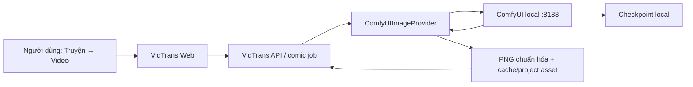

# Phân tích tính năng — Tích hợp ComfyUI với VidTrans

- Feature: `comfyui-integration`
- Ngày phân tích: 2026-10-24
- Trạng thái: `DRAFT — chờ review phạm vi`

## 1. Vấn đề và mục tiêu

Người dùng yêu cầu tích hợp ComfyUI local với ứng dụng VidTrans. Kiểm tra mã nguồn cho thấy lớp tích hợp ứng dụng đã tồn tại, nhưng môi trường local chưa đủ điều kiện để chạy một lượt sinh ảnh thật.

Mục tiêu đo được của đợt này:

1. VidTrans nhận biết ComfyUI local đã sẵn sàng.
2. Người dùng chọn được `ComfyUI local (AI, miễn phí)` trong **Truyện → Video**.
3. Một prompt kiểm thử được gửi từ VidTrans tới ComfyUI, ảnh PNG kết quả được tải về và chuẩn hóa đúng kích thước.
4. Khi ComfyUI hoặc checkpoint không sẵn sàng, hệ thống báo lỗi có thể hành động và vẫn giữ cơ chế fallback hiện hữu.

## 2. Nguồn bằng chứng

| Source ID | Nguồn | Bằng chứng | Trạng thái |
|---|---|---|---|
| SRC_01 | `backend/infrastructure/image_providers.py` | Có `ComfyUIImageProvider`, workflow node lõi, queue/poll/history/view và factory | CONFIRMED |
| SRC_02 | `backend/application/comic_service.py` | Comic job khởi tạo image provider từ settings và truyền vào producer | CONFIRMED |
| SRC_03 | `backend/domain/comic.py` | `image_provider` chấp nhận `comfyui` | CONFIRMED |
| SRC_04 | `web/js/comic.js`, `web/index.html` | UI hiển thị provider và ưu tiên ComfyUI khi đã cấu hình | CONFIRMED |
| SRC_05 | `docker-compose.yml` | Backend nhận các biến `VIDTRANS_COMFYUI_*` | CONFIRMED |
| SRC_06 | `backend/tests/test_image_providers.py` | Có unit test workflow, seed, tải và resize ảnh | CONFIRMED |
| SRC_07 | `docs/comfyui-image-generation.md`, `deploy/comfyui-local.sh` | Có hướng dẫn và script quản lý runtime local | CONFIRMED |
| SRC_08 | Smoke test local ngày 2026-10-24 | ComfyUI 0.36.0 chạy trên Apple MPS và `/system_stats` trả thành công | CONFIRMED |

## 3. AS-IS

- ComfyUI 0.36.0 đã được cài trong `comfyui/app/.venv` và có thể chạy bằng Apple MPS.
- API adapter của VidTrans đã hỗ trợ gửi workflow core-node tới `/prompt`, poll `/history/{prompt_id}` và tải `/view`.
- UI chỉ bật lựa chọn ComfyUI khi có cả URL và tên checkpoint trong cấu hình tiến trình backend.
- Thư mục `comfyui/models/checkpoints` hiện chỉ có `.gitkeep`; chưa có checkpoint thực tế.
- Chưa có bằng chứng một comic job local đã sinh ảnh thật qua ComfyUI.

## 4. TO-BE đề xuất

VidTrans và ComfyUI chỉ giao tiếp qua mạng local. Không mở cổng 8188 ra Internet. Tên checkpoint được cấu hình bằng tên file, không hardcode vào source.

## 5. Actor và hệ thống ảnh hưởng

| Actor/hệ thống | Vai trò |
|---|---|
| Người dùng VidTrans | Chọn ComfyUI và tạo storyboard/video |
| VidTrans Web/API/worker | Xác thực request, chạy job, quản lý artifact/fallback |
| ComfyUI local | Thực thi workflow sinh ảnh |
| Checkpoint model | Cung cấp model weights; license và dung lượng phụ thuộc model được chọn |

## 6. Phạm vi đề xuất

### Trong phạm vi

- Hoàn thiện cấu hình local/Docker để backend truy cập ComfyUI.
- Bổ sung kiểm tra readiness/configuration có thông tin hành động được nếu kiểm tra hiện tại chưa đủ.
- Giữ workflow node lõi và contract provider hiện hữu.
- Unit/integration test cô lập; smoke test thật một ảnh sau khi có checkpoint.
- Cập nhật tài liệu vận hành và hồ sơ kiểm thử.

### Ngoài phạm vi

- Tải một checkpoint cụ thể trước khi người dùng chọn model/license/dung lượng.
- IP-Adapter, ControlNet, LoRA, custom nodes hoặc consistency bằng ảnh tham chiếu.
- Public expose cổng ComfyUI, auth proxy Internet hoặc triển khai production.
- Thay đổi DB, SQL, Camunda hay API mobile công khai nếu không phát sinh contract mới.

## 7. Yêu cầu và tiêu chí nghiệm thu sơ bộ

| ID | Nội dung |
|---|---|
| AC01_01 | Khi URL và checkpoint hợp lệ, `/api/v1/comic/options` (hoặc route options hiện hữu) trả ComfyUI ở trạng thái có thể chọn. |
| AC01_02 | Một comic preview dùng `image_provider=comfyui` tạo PNG thật đúng kích thước đích. |
| AC01_03 | Backend chạy Docker truy cập instance host qua `host.docker.internal`; backend native dùng `127.0.0.1`. |
| AC01_04 | ComfyUI mất kết nối/model sai không làm lộ raw payload nhạy cảm và kích hoạt hành vi fallback/cảnh báo hiện hữu. |
| AC01_05 | Cổng 8188 không được cấu hình public trong bộ triển khai VidTrans. |

## 8. Rủi ro và giả định

- `OPEN`: chưa chọn checkpoint; model có thể nặng nhiều GB và có điều khoản license riêng.
- `ASSUMPTION`: mục tiêu trước mắt là pipeline comic ảnh tĩnh, không phải video diffusion.
- `CONFIRMED`: ComfyUI local nhận Apple MPS khi chạy ngoài sandbox.
- `RISK`: `--listen 0.0.0.0` cần cho Docker Desktop nhưng tăng bề mặt truy cập trong LAN; phải giới hạn bằng firewall/network và không publish Internet.
- `RISK`: workflow core hiện giả định checkpoint kiểu Stable Diffusion tương thích `CheckpointLoaderSimple`/CLIP/VAE; checkpoint kiến trúc khác có thể cần workflow riêng.

## 9. Câu hỏi cần quyết định

1. Chọn checkpoint nào để smoke test thật? Cần xác nhận tên model, nguồn tải, license và dung lượng chấp nhận được.
2. VidTrans đang chạy native hay bằng Docker Compose trong môi trường local đích? Kế hoạch hỗ trợ cả hai, nhưng smoke test chỉ cần một đường chạy.

