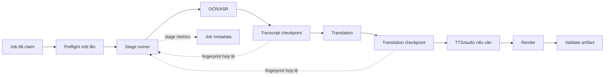

# URD — Tối ưu pipeline nhận diện, dịch và ghép video

## Metadata và quản lý phiên bản

- Hệ thống: VidTrans
- Feature: `media-pipeline-optimization`
- Version: `0.1`
- Trạng thái: `DRAFT — plan đã duyệt, URD chờ review`
- Người soạn: Codex
- Người review: OPEN — người dùng/chủ sản phẩm
- Ngày: 2026-10-16

| Version | Ngày | Nội dung | Nguồn quyết định |
|---|---|---|---|
| 0.1 | 2026-10-16 | Đặc tả metrics, hardening, checkpoint/cache và tối ưu theo stage | Plan 0.1 được người dùng duyệt bằng “bắt đầu làm” |

## I. THÔNG TIN CHUNG

### 1. Mục đích tài liệu

Đặc tả yêu cầu để giảm thời gian và tài nguyên xử lý video, tăng khả năng retry/resume, không làm giảm chất lượng transcript/bản dịch/TTS/render và cung cấp số liệu định lượng cho việc rollout.

### 2. Phạm vi dự án

Trong phạm vi:

- Pipeline từ media local qua preflight, OCR/ASR, translation, subtitle layout, TTS/audio và render.
- Stage metrics, atomic artifact, checkpoint/fingerprint, cache trong phạm vi đã duyệt và resource coordination.
- Job/status metadata và progress cần để vận hành.
- Unit/integration/benchmark/regression và bộ hồ sơ rollout.

Ngoài phạm vi:

- Tải video nguồn và đăng mạng xã hội.
- Thêm ngôn ngữ hoặc OCR ngoài tiếng Trung.
- Redis/multi-host trong lát đầu.
- Tự deploy production.

Giới hạn hiện tại:

- Golden corpus và cấu hình VPS production chưa được chốt.
- Cross-job cache chỉ được thiết kế, chưa bật trước khi chốt TTL/scope/delete policy.
- Hardware encoder chưa được chọn trước benchmark capability/chất lượng.

### 3. Thuật ngữ và viết tắt

| Thuật ngữ | Ý nghĩa trong tính năng |
|---|---|
| Stage | Một bước xử lý có input/output và trạng thái độc lập. |
| RTF | Real-time factor = số giây xử lý / số giây video. |
| Fingerprint | Khóa xác định input, option, engine/model/provider và schema của stage. |
| Checkpoint | Artifact + manifest đã commit atomically và đủ điều kiện resume. |
| Golden corpus | Bộ video và dữ liệu chuẩn được phép dùng để đo chất lượng/hiệu năng. |
| WER/CER | Chỉ số sai từ/ký tự cho ASR/OCR. |

### 4. Quản lý tài liệu và nguồn tham chiếu

| Source ID | Tên/đường dẫn | Version/mục | Trạng thái | Yêu cầu liên quan |
|---|---|---|---|---|
| SRC_01 | `ANALYSIS.md` | 0.1 | Đã đọc | Tất cả UC/NFR |
| SRC_02 | `PLAN.md` | 0.1 APPROVED | Đã đọc | Tất cả UC/NFR |
| SRC_03 | `ARCHITECTURE.md` | Current | Đã đọc | UC_02, UC_04 |
| SRC_04 | `backend/main.py` | Current | Đã đọc | UC_01–UC_04 |
| SRC_05 | `backend/pipeline/asr.py`, `ocr.py`, `translation.py` | Current | Đã đọc | UC_01, UC_03 |
| SRC_06 | `backend/application/job_scheduler.py`, `backend/infrastructure/job_store.py` | Current | Đã đọc | UC_02, UC_04 |
| SRC_07 | Golden corpus + production host profile | N/A | MISSING | NFR_01–NFR_04 |

## II. MÔ TẢ TỔNG QUAN HỆ THỐNG

### 1. Actor

| Actor | Loại | Trách nhiệm/quyền |
|---|---|---|
| Quản trị viên | User đã xác thực khi auth bật | Tạo/retry/cancel job, xem tiến trình và artifact của deployment. |
| Job scheduler | Service | Claim job và gọi pipeline runner. |
| Pipeline runner | Service | Thực thi stage, ghi metrics/checkpoint và dừng khi cancel/lỗi. |
| ASR/OCR/translation/TTS provider | Internal/external service | Trả kết quả theo contract của từng stage. |
| Người vận hành | User/service operator | Theo dõi metric, capability, quota và quyết định rollout/rollback. |

Không thay đổi authn/authz hiện tại; job/status vẫn đi qua boundary hiện hữu. Metric không được chứa transcript, bản dịch, token, URL proxy hoặc credential.

### 2. AS-IS/TO-BE

Pipeline chạy bất đồng bộ. API chấp nhận job không đồng nghĩa video đã hoàn thành. Stage chỉ được coi là hoàn tất sau khi output được validate và manifest/artifact được commit.

## III. ĐẶC TẢ YÊU CẦU CHI TIẾT

### UC_01 — Quan sát thời gian và kết quả từng stage

| Thuộc tính | Nội dung |
|---|---|
| Description | Là người vận hành, tôi cần metric theo stage để xác định bottleneck và regression. |
| Actor | Pipeline runner, người vận hành |
| Trigger | Job bắt đầu một stage có đo lường. |
| Pre-condition | Job tồn tại và runner đã claim hợp lệ. |
| Post-condition | Job lưu metric hoàn tất/thất bại/hủy mà không chứa nội dung người dùng. |

| Bước MF | Actor/hệ thống | Hành động/input | Kết quả | BR |
|---|---|---|---|---|
| MF01_01 | Pipeline runner | Bắt đầu stage bằng tên chuẩn | Ghi thời điểm monotonic nội bộ | BR01_01 |
| MF01_02 | Pipeline runner | Stage hoàn tất/lỗi/hủy | Tính duration, status và RTF nếu có video duration | BR01_01, BR01_02 |
| MF01_03 | Job service | Merge metric vào job | Status API có dữ liệu stage mới, không phá field cũ | BR01_03 |

EF01_01: Nếu callback ghi metric lỗi, lỗi telemetry phải được log sanitize và không được che nguyên nhân pipeline ban đầu.

| Mã BR | Điều kiện | Quy tắc/kết quả | Nguồn | Trạng thái |
|---|---|---|---|---|
| BR01_01 | Stage được đo | Duration dùng monotonic clock, không âm; RTF chỉ có khi video duration > 0. | SRC_01 | CONFIRMED |
| BR01_02 | Stage ném exception/cancel | Metric ghi `failed`/`cancelled` rồi exception gốc tiếp tục được propagate. | SRC_01/SRC_04 | CONFIRMED |
| BR01_03 | Lưu metric | Chỉ lưu tên stage, duration, status, RTF và timestamp; cấm transcript/secret trong metric. | SRC_01 | CONFIRMED |

| AC | UC/BR | Given | When | Then |
|---|---|---|---|---|
| AC01_01 | UC_01/BR01_01 | Stage thành công, video duration hợp lệ | Timer kết thúc | Job có duration và RTF làm tròn ổn định. |
| AC01_02 | UC_01/BR01_02 | Stage ném lỗi tổng hợp | Timer kết thúc | Metric là `failed` và caller nhận đúng exception gốc. |
| AC01_03 | UC_01/BR01_03 | Metric được serialize | Đọc status job | Không có source text, translation text hoặc credential. |

### UC_02 — Resume từ checkpoint hợp lệ

| Thuộc tính | Nội dung |
|---|---|
| Description | Là quản trị viên, tôi cần retry chỉ chạy lại stage lỗi và downstream để không tốn lại ASR/dịch. |
| Actor | Quản trị viên, scheduler, pipeline runner |
| Trigger | Retry hoặc restart job. |
| Pre-condition | Source còn tồn tại; checkpoint có manifest version được hỗ trợ. |
| Post-condition | Stage hợp lệ được reuse; checkpoint sai/corrupt bị bỏ qua an toàn. |

| Bước MF | Actor/hệ thống | Hành động/input | Kết quả | BR |
|---|---|---|---|---|
| MF02_01 | Runner | Tính fingerprint stage | Có khóa input/config/version | BR02_01 |
| MF02_02 | Runner | Đọc manifest/artifact | Validate version, checksum và fingerprint | BR02_02 |
| MF02_03 | Runner | Match hợp lệ | Reuse output, ghi cache hit | BR02_03 |
| MF02_04 | Runner | Không match | Chạy stage và downstream, commit atomically | BR02_02, BR02_04 |

AF02_01: Job cũ không có manifest chạy full pipeline theo đường compatibility.

| Mã BR | Điều kiện | Quy tắc/kết quả | Nguồn | Trạng thái |
|---|---|---|---|---|
| BR02_01 | Tạo fingerprint | Bao gồm source/input checksum, option ảnh hưởng kết quả, engine/model/provider và schema version. | SRC_01/SRC_03 | CONFIRMED |
| BR02_02 | Artifact đang ghi hoặc corrupt | Không được đánh dấu complete/reuse; không xóa source/output hợp lệ khác. | SRC_01 | CONFIRMED |
| BR02_03 | Reuse | Chỉ reuse trong scope privacy đã duyệt; lát đầu mặc định per-job. | SRC_01 | CONFIRMED |
| BR02_04 | Commit | Ghi file tạm, flush và atomic replace trước khi cập nhật manifest/job. | SRC_01 | CONFIRMED |

| AC | UC/BR | Given | When | Then |
|---|---|---|---|---|
| AC02_01 | UC_02/BR02_03 | Translation checkpoint hợp lệ, render cũ lỗi | Retry | ASR và translation không bị gọi lại. |
| AC02_02 | UC_02/BR02_02 | Manifest/artifact corrupt | Retry | Stage được chạy lại, không trả output corrupt. |
| AC02_03 | UC_02/BR02_04 | Process chết giữa lúc ghi | Resume | Không có checkpoint complete trỏ vào file ghi dở. |

### UC_03 — Chạy nhận diện/dịch/TTS theo profile có quality gate

| Thuộc tính | Nội dung |
|---|---|
| Description | Là quản trị viên, tôi cần cấu hình tối ưu nhưng không bị giảm chất lượng âm thầm. |
| Actor | Quản trị viên, pipeline runner |
| Trigger | Tạo job với profile được hỗ trợ. |
| Pre-condition | Profile/engine/provider hợp lệ. |
| Post-condition | Output qua quality gate hoặc job fail/review rõ ràng. |

| Mã BR | Điều kiện | Quy tắc/kết quả | Nguồn | Trạng thái |
|---|---|---|---|---|
| BR03_01 | Profile chưa được chốt | Giữ hành vi hiện tại như profile quality/balanced compatibility; không tự bật Fast. | SRC_01 | CONFIRMED |
| BR03_02 | OCR/ASR thích nghi | Chỉ bỏ full reconciliation khi policy và quality gate đã được duyệt/test. | SRC_01 | CONFIRMED |
| BR03_03 | Translation/TTS song song | Concurrency bị giới hạn theo provider/CPU; không retry vô hạn hoặc hammer provider. | SRC_01/SRC_05 | CONFIRMED |
| BR03_04 | Một TTS worker lỗi | Hủy pending khi có thể, propagate lỗi với cue index đã sanitize; cấm xuất video thiếu cue âm thầm. | SRC_01/SRC_04 | CONFIRMED |

| AC | UC/BR | Given | When | Then |
|---|---|---|---|---|
| AC03_01 | UC_03/BR03_04 | Một future TTS lỗi | Thu thập kết quả | Pipeline fail tại TTS và không tiếp tục render thành công. |
| AC03_02 | UC_03/BR03_03 | Provider 429/timeout | Retry | Tuân thủ limit/backoff, metric phản ánh failure/retry. |
| AC03_03 | UC_03/BR03_01 | Job legacy | Chạy sau nâng cấp | Output giữ compatibility nếu flag tối ưu tắt. |

### UC_04 — Render và vận hành trong giới hạn tài nguyên

| Thuộc tính | Nội dung |
|---|---|
| Description | Là người vận hành, tôi cần pipeline không làm đầy disk hoặc quá tải CPU/RAM khi chạy batch. |
| Actor | Scheduler, pipeline runner, người vận hành |
| Trigger | Nhiều job hoặc render/fallback nặng. |
| Pre-condition | Capability và quota đã được cấu hình/preflight. |
| Post-condition | Job chạy trong budget hoặc dừng rõ; rollback được bằng feature flag. |

| Mã BR | Điều kiện | Quy tắc/kết quả | Nguồn | Trạng thái |
|---|---|---|---|---|
| BR04_01 | Xử lý source media | Probe width/height/duration/fps/audio một lần trong job và truyền xuống stage. | SRC_01/SRC_04 | CONFIRMED |
| BR04_02 | Encoder/filter không có | Fail/preflight hoặc fallback đã kiểm chứng; không chờ đến cuối job mới phát hiện nếu capability biết được. | SRC_01 | CONFIRMED |
| BR04_03 | Temp disk vượt ngưỡng | Không bung Pillow/frame cache không giới hạn; dừng với lỗi vận hành rõ. | SRC_01 | CONFIRMED |
| BR04_04 | Rollout | Mỗi tối ưu rủi ro cao có flag độc lập; đường hiện tại là fallback trong canary. | SRC_02 | CONFIRMED |

| AC | UC/BR | Given | When | Then |
|---|---|---|---|---|
| AC04_01 | UC_04/BR04_01 | Một video chuẩn | Pipeline chạy | Source metadata chỉ cần một probe tổng hợp trong luồng chính. |
| AC04_02 | UC_04/BR04_04 | Flag tối ưu tắt | Job chạy | Hành vi compatibility còn hoạt động. |

### 3. Dữ liệu và trạng thái

| Field/artifact | Kiểu | Bắt buộc | Nguồn | Validation/masking | Lưu trữ |
|---|---|---|---|---|---|
| `stage_metrics` | object map | Optional/additive | Pipeline timer | Stage name allow-list; không chứa text/secret | JSON payload job hiện hữu |
| `duration_seconds` | float | Conditional | Monotonic clock | >= 0, làm tròn | `stage_metrics.<stage>` |
| `real_time_factor` | float | Optional | duration/video duration | Chỉ khi video duration > 0 | `stage_metrics.<stage>` |
| `stage_manifest.json` | Versioned JSON | Phase checkpoint | Runner | Schema/fingerprint/checksum | Work dir per job |
| transcript/translation/audio/render artifact | File | Theo mode/stage | Pipeline | Validate tồn tại/schema/duration/checksum | Work/output hiện hữu |

Không thay đổi schema SQLite trong lát đầu vì job payload là JSON. SQL/Camunda/Kafka: N/A cho feature hiện tại.

### 4. Yêu cầu phi chức năng

| NFR ID | Yêu cầu | Tiêu chí đo | Cách kiểm tra | Trạng thái |
|---|---|---|---|---|
| NFR_01 | Hiệu năng | Mục tiêu đề xuất p50 -30%, p95 -20% theo mode/corpus/hardware | Benchmark ≥3 lần/case | OPEN đến khi có baseline |
| NFR_02 | Chất lượng ASR/OCR | WER/CER không tăng >1 điểm % tuyệt đối | Golden corpus | OPEN do SRC_07 MISSING |
| NFR_03 | Chất lượng translation/TTS | Không tăng source fallback; missing TTS cue = 0 | Reference/human rubric + integration | CONFIRMED guardrail |
| NFR_04 | Render | Output phát được, timeline/audio/subtitle hợp lệ | ffprobe + quality check | CONFIRMED guardrail |
| NFR_05 | Privacy | Metric/log không chứa transcript, translation, token/credential | Unit/review log schema | CONFIRMED |
| NFR_06 | Reliability | Artifact/checkpoint commit atomically; lỗi worker không bị nuốt | Crash/failure tests | CONFIRMED |
| NFR_07 | Compatibility | Job/API cũ tiếp tục chạy khi feature flag tắt hoặc chưa có manifest | Regression tests | CONFIRMED |

## IV. PHỤ LỤC

### API

- Không thêm endpoint bắt buộc trong lát đầu.
- `/status/{job_id}` và API job hiện hữu có thể trả thêm `stage_metrics` theo contract additive.
- Auth/correlation/error contract hiện tại được giữ nguyên.

### DB/Kafka/Camunda

- DB migration: N/A ở lát đầu; lưu field additive trong JSON payload hiện hữu.
- Kafka: N/A.
- BPMN/DMN: N/A.

### Tài liệu liên quan

- `OPEN_QUESTIONS.md`
- `REVIEW.md`
- `TRACEABILITY.md`
- `DEV/media-pipeline-optimization/DESIGN.md`
